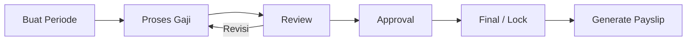

# Rancangan Aplikasi HCMS (Human Capital Management System)

## 1. Tujuan

Aplikasi untuk mengelola data karyawan, absensi, penggajian (gaji, tunjangan, potongan), register gaji, slip gaji (payslip), serta pelaporan yang dapat diekspor ke XLSX dan PDF.

## 2. Peran Pengguna (Role)

| Role | Hak Akses |
|---|---|
| Super Admin | Semua menu, manajemen user & role |
| HR Admin | Karyawan, absensi, gaji, allowances/deductions, report |
| Payroll Officer | Gaji, allowances/deductions, register gaji, payslip, report gaji |
| Manager | Lihat karyawan & absensi bawahan, report terbatas |
| Karyawan | Lihat profil sendiri, absensi sendiri, payslip sendiri |

### Basic RBAC (Role-Based Access Control)

**Model:** `users` -> `roles` -> `permissions` (melalui `role_permissions`). Satu user memiliki satu role. Permission berformat `modul.aksi`, contoh `employee.view`, `payroll.approve`.

**Aksi standar:** `view`, `create`, `update`, `delete`, `export`, serta aksi khusus (`approve`, `process`, `finalize`, `reopen`, `send`).

**Data scope** pada role menentukan cakupan data yang boleh dilihat:

| Scope | Arti |
|---|---|
| `all` | Seluruh data perusahaan |
| `department` | Data departemen sendiri |
| `subordinate` | Data bawahan langsung/tidak langsung |
| `self` | Hanya data milik sendiri |

**Matriks akses menu** (V = view, C = create, U = update, D = delete, A = approve, E = export, P = process, F = finalize):

| Menu | Super Admin | HR Admin | Payroll Officer | Manager | Karyawan |
|---|---|---|---|---|---|
| Dashboard | V | V | V | V | V (ringkas) |
| Data Karyawan | VCUDE | VCUE | V | V (bawahan) | V (diri sendiri) |
| Absensi | VCUDAE | VCUAE | V | VA (bawahan) | V (diri sendiri), ajukan cuti/lembur |
| Data Gaji | VCUE | V | VCUE | - | - |
| Allowances & Deductions | VCUDE | V | VCUDE | - | - |
| Register Gaji | VPAF | V | VPF | - | - |
| Payslip | VE | V | VE + kirim | - | V (milik sendiri) |
| Report | VE | VE (non-gaji) | VE (gaji) | VE (bawahan) | - |
| Pengaturan, User & Role, Audit Log | VCUD | - | - | - | - |

**Aturan:**
- Pengecekan dilakukan di backend (middleware/policy), bukan hanya dengan menyembunyikan menu.
- Menu yang tidak punya permission `view` tidak ditampilkan.
- Data sensitif (gaji, rekening, NPWP) hanya untuk role dengan permission terkait.
- Role bawaan (`is_system`) tidak dapat dihapus; Super Admin otomatis memiliki semua permission.
- Perubahan role/permission dan percobaan akses ditolak dicatat di `audit_logs`.

**Daftar permission (seed awal):**

| Modul | Permission |
|---|---|
| dashboard | `dashboard.view` |
| employee | `employee.view`, `.create`, `.update`, `.delete`, `.export` |
| attendance | `attendance.view`, `.create`, `.update`, `.approve`, `.export` |
| salary | `salary.view`, `.create`, `.update`, `.export` |
| component | `component.view`, `.create`, `.update`, `.delete` |
| payroll | `payroll.view`, `.process`, `.approve`, `.finalize`, `.reopen`, `.export` |
| payslip | `payslip.view`, `.view_own`, `.export`, `.send` |
| report | `report.view`, `.export` (per jenis report: `report.salary`, `report.attendance`, dst.) |
| setting | `setting.manage`, `user.manage`, `role.manage`, `audit.view` |

## 3. Struktur Menu

```
1. Dashboard
2. Data Karyawan
   2.1 Daftar Karyawan
   2.2 Tambah/Edit Karyawan
   2.3 Detail Karyawan (profil, kontrak, bank, keluarga)
   2.4 Master: Departemen, Jabatan, Lokasi Kerja
3. Data Absensi Karyawan
   3.1 Rekap Absensi Harian
   3.2 Input/Koreksi Absensi
   3.3 Cuti & Izin
   3.4 Lembur
   3.5 Jadwal/Shift
   3.6 Import Absensi (mesin fingerprint / xlsx)
4. Data Gaji Karyawan
   4.1 Daftar Gaji Pokok per Karyawan
   4.2 Riwayat Perubahan Gaji
   4.3 Pengaturan Komponen Gaji Karyawan
5. Allowances & Deductions
   5.1 Master Komponen (Allowance / Deduction)
   5.2 Komponen per Karyawan (tetap/berulang)
   5.3 Komponen Sekali Bayar (one-time/adhoc)
6. Register Gaji (Payroll Register)
   6.1 Periode Penggajian
   6.2 Proses Gaji (generate)
   6.3 Review & Approval
   6.4 Finalisasi / Lock Periode
   6.5 Detail Register per Karyawan
7. Payslip
   7.1 Daftar Payslip per Periode
   7.2 Preview & Cetak PDF
   7.3 Kirim Email Payslip
   7.4 Payslip Saya (self service)
8. Report
   8.1 Pilih Jenis Report
   8.2 Filter (periode, departemen, karyawan, status)
   8.3 Preview
   8.4 Export XLSX / PDF
9. Pengaturan
   9.1 User & Role
   9.2 Pengaturan Perusahaan
   9.3 Pengaturan Pajak/BPJS
   9.4 Hari Libur
   9.5 Audit Log
```

## 4. Detail Menu

### 4.1 Dashboard
- Total karyawan aktif, karyawan baru, resign.
- Kehadiran hari ini (hadir, terlambat, izin, cuti, alpha).
- Total biaya gaji periode terakhir.
- Pengingat: kontrak akan berakhir, periode gaji belum final.

### 4.2 Data Karyawan
**Fitur:** CRUD, pencarian, filter (departemen, jabatan, status), import/export XLSX, upload dokumen, nonaktifkan (resign).

**Field utama:**
- Identitas: NIK karyawan, nama, KTP, NPWP, jenis kelamin, tempat/tgl lahir, agama, status nikah, jumlah tanggungan, alamat, telepon, email, foto.
- Kepegawaian: departemen, jabatan, lokasi, atasan langsung, status (tetap/kontrak/magang), tanggal masuk, tanggal keluar, status aktif.
- Kontrak: jenis, tanggal mulai, tanggal selesai.
- Bank: nama bank, no. rekening, atas nama.
- BPJS: no. BPJS Kesehatan, no. BPJS Ketenagakerjaan.
- Dokumen: KTP, ijazah, kontrak, dll.

### 4.3 Data Absensi Karyawan
**Fitur:**
- Rekap harian/bulanan per karyawan: jam masuk, jam pulang, keterlambatan, pulang cepat, total jam kerja.
- Status: Hadir, Terlambat, Izin, Sakit, Cuti, Alpha, Libur, Dinas.
- Koreksi manual dengan alasan dan approval.
- Pengajuan cuti/izin dengan alur approval atasan -> HR.
- Pengajuan lembur dengan approval.
- Jadwal shift dan jam kerja.
- Import dari mesin absensi/XLSX.
- Rekap bulanan menjadi dasar perhitungan potongan dan lembur pada gaji.

### 4.4 Data Gaji Karyawan
**Fitur:**
- Gaji pokok per karyawan dengan tanggal efektif.
- Riwayat perubahan gaji (kenaikan, promosi) beserta alasan.
- Skema gaji: bulanan / harian / per jam.
- Penetapan komponen tetap (tunjangan & potongan) per karyawan.
- Status PTKP untuk perhitungan pajak.

### 4.5 Allowances & Deductions
**Master Komponen:**
- Kode, nama, tipe (Allowance / Deduction), sifat (tetap / variabel), cara hitung (nominal, persentase gaji pokok, per hari kehadiran, rumus), kena pajak (ya/tidak), aktif.
- Contoh Allowance: tunjangan jabatan, transport, makan, komunikasi, lembur, bonus, THR.
- Contoh Deduction: BPJS Kesehatan, BPJS TK (JHT/JP), PPh 21, potongan keterlambatan, potongan alpha, kasbon/pinjaman.

**Komponen per Karyawan:** assign komponen, nominal/persen, periode berlaku (mulai–selesai).

**Komponen Sekali Bayar:** input bonus/potongan untuk periode tertentu, dengan keterangan.

**Pinjaman/Kasbon (opsional):** total pinjaman, cicilan per bulan, sisa; otomatis menjadi deduction.

### 4.6 Register Gaji
**Alur:**


**Proses perhitungan per karyawan:**
1. Ambil gaji pokok aktif pada periode.
2. Tambah allowance tetap + sekali bayar + lembur (dari absensi).
3. Kurangi deduction tetap + sekali bayar + potongan absensi + cicilan pinjaman.
4. Hitung BPJS dan PPh 21.
5. Gaji bersih (take home pay) = gaji pokok + total allowance - total deduction.

**Register menampilkan:** karyawan, gaji pokok, total allowance, total deduction, pajak, gaji bersih, status. Dapat diekspor ke XLSX/PDF. Setelah final, data terkunci (snapshot).

### 4.7 Payslip
- Dibuat otomatis dari register gaji yang sudah final.
- Isi: data perusahaan, data karyawan, periode, rincian pendapatan, rincian potongan, gaji bersih, ringkasan kehadiran, nomor slip.
- Aksi: preview, cetak/unduh PDF, kirim email (massal atau individu), karyawan dapat mengunduh sendiri.
- PDF dapat diberi password (tanggal lahir/NIK).

### 4.8 Report
Pengguna memilih jenis report, mengisi filter, preview, lalu memilih format export (XLSX atau PDF).

| Kategori | Report |
|---|---|
| Karyawan | Daftar karyawan, karyawan masuk/keluar, kontrak akan berakhir, headcount per departemen |
| Absensi | Rekap absensi bulanan, keterlambatan, cuti & izin, lembur |
| Gaji | Register gaji, rekap gaji per departemen, riwayat gaji karyawan |
| Allowance/Deduction | Rekap allowance, rekap deduction, saldo pinjaman |
| Pajak & BPJS | Rekap PPh 21, rekap BPJS |
| Transfer Bank | Daftar transfer gaji per bank |

**Mekanisme:** tabel `report_definitions` menyimpan daftar report; setiap report memiliki parameter filter. Export XLSX (mis. Laravel Excel / PhpSpreadsheet) dan PDF (mis. DomPDF / Snappy).

## 5. ERD

```mermaid
erDiagram
    USERS ||--o| EMPLOYEES : "terkait"
    USERS }o--|| ROLES : "memiliki"
    ROLES ||--o{ ROLE_PERMISSIONS : "memiliki"
    PERMISSIONS ||--o{ ROLE_PERMISSIONS : "diberikan"

    COMPANIES ||--o{ DEPARTMENTS : "memiliki"
    COMPANIES ||--o{ WORK_LOCATIONS : "memiliki"
    DEPARTMENTS ||--o{ EMPLOYEES : "berisi"
    POSITIONS ||--o{ EMPLOYEES : "dijabat"
    WORK_LOCATIONS ||--o{ EMPLOYEES : "bekerja di"
    EMPLOYEES ||--o{ EMPLOYEES : "atasan"

    EMPLOYEES ||--o{ EMPLOYEE_CONTRACTS : "memiliki"
    EMPLOYEES ||--o{ EMPLOYEE_DOCUMENTS : "memiliki"
    EMPLOYEES ||--o{ EMPLOYEE_BANK_ACCOUNTS : "memiliki"
    EMPLOYEES ||--o{ EMPLOYEE_FAMILIES : "memiliki"

    SHIFTS ||--o{ EMPLOYEE_SCHEDULES : "dipakai"
    EMPLOYEES ||--o{ EMPLOYEE_SCHEDULES : "dijadwalkan"
    EMPLOYEES ||--o{ ATTENDANCES : "absen"
    EMPLOYEES ||--o{ LEAVE_REQUESTS : "mengajukan"
    LEAVE_TYPES ||--o{ LEAVE_REQUESTS : "jenis"
    EMPLOYEES ||--o{ OVERTIME_REQUESTS : "mengajukan"
    HOLIDAYS }o--|| COMPANIES : "milik"

    EMPLOYEES ||--o{ EMPLOYEE_SALARIES : "memiliki"
    PAY_COMPONENTS ||--o{ EMPLOYEE_COMPONENTS : "dipakai"
    EMPLOYEES ||--o{ EMPLOYEE_COMPONENTS : "memiliki"
    PAY_COMPONENTS ||--o{ ADHOC_COMPONENTS : "dipakai"
    EMPLOYEES ||--o{ ADHOC_COMPONENTS : "menerima"
    EMPLOYEES ||--o{ LOANS : "meminjam"
    LOANS ||--o{ LOAN_INSTALLMENTS : "dicicil"

    PAYROLL_PERIODS ||--o{ PAYROLL_REGISTERS : "berisi"
    EMPLOYEES ||--o{ PAYROLL_REGISTERS : "digaji"
    PAYROLL_REGISTERS ||--o{ PAYROLL_REGISTER_ITEMS : "rincian"
    PAY_COMPONENTS ||--o{ PAYROLL_REGISTER_ITEMS : "komponen"
    PAYROLL_REGISTERS ||--o| PAYSLIPS : "menghasilkan"

    REPORT_DEFINITIONS ||--o{ REPORT_EXPORTS : "dijalankan"
    USERS ||--o{ REPORT_EXPORTS : "oleh"
    USERS ||--o{ AUDIT_LOGS : "aktivitas"

    USERS {
        bigint id PK
        bigint role_id FK
        string name
        string email UK
        string password
        boolean is_active
        timestamp last_login_at
    }
    ROLES {
        bigint id PK
        string name UK
        string description
        string data_scope "all|department|subordinate|self"
        boolean is_system
    }
    PERMISSIONS {
        bigint id PK
        string code UK
        string module
        string action
        string description
    }
    ROLE_PERMISSIONS {
        bigint role_id FK
        bigint permission_id FK
    }
    COMPANIES {
        bigint id PK
        string name
        string npwp
        text address
        string logo
    }
    DEPARTMENTS {
        bigint id PK
        bigint company_id FK
        string code UK
        string name
    }
    POSITIONS {
        bigint id PK
        string code UK
        string name
        string level
    }
    WORK_LOCATIONS {
        bigint id PK
        bigint company_id FK
        string name
        text address
    }
    EMPLOYEES {
        bigint id PK
        bigint user_id FK
        bigint department_id FK
        bigint position_id FK
        bigint work_location_id FK
        bigint manager_id FK
        string employee_no UK
        string full_name
        string nik_ktp
        string npwp
        string gender
        date birth_date
        string birth_place
        string marital_status
        string ptkp_status
        string phone
        string email
        text address
        string employment_status
        date join_date
        date resign_date
        string bpjs_kesehatan_no
        string bpjs_tk_no
        boolean is_active
    }
    EMPLOYEE_CONTRACTS {
        bigint id PK
        bigint employee_id FK
        string contract_type
        date start_date
        date end_date
        string file_path
    }
    EMPLOYEE_DOCUMENTS {
        bigint id PK
        bigint employee_id FK
        string doc_type
        string file_path
    }
    EMPLOYEE_BANK_ACCOUNTS {
        bigint id PK
        bigint employee_id FK
        string bank_name
        string account_no
        string account_name
        boolean is_primary
    }
    EMPLOYEE_FAMILIES {
        bigint id PK
        bigint employee_id FK
        string name
        string relationship
        date birth_date
    }
    SHIFTS {
        bigint id PK
        string name
        time start_time
        time end_time
        int late_tolerance_min
    }
    EMPLOYEE_SCHEDULES {
        bigint id PK
        bigint employee_id FK
        bigint shift_id FK
        date work_date
    }
    ATTENDANCES {
        bigint id PK
        bigint employee_id FK
        date attendance_date
        time check_in
        time check_out
        int late_minutes
        int early_leave_minutes
        decimal work_hours
        string status
        string source
        text notes
        bigint corrected_by FK
    }
    LEAVE_TYPES {
        bigint id PK
        string name
        int default_quota
        boolean is_paid
    }
    LEAVE_REQUESTS {
        bigint id PK
        bigint employee_id FK
        bigint leave_type_id FK
        date start_date
        date end_date
        int total_days
        text reason
        string status
        bigint approved_by FK
        timestamp approved_at
    }
    OVERTIME_REQUESTS {
        bigint id PK
        bigint employee_id FK
        date overtime_date
        decimal hours
        text reason
        string status
        bigint approved_by FK
    }
    HOLIDAYS {
        bigint id PK
        bigint company_id FK
        date holiday_date
        string name
    }
    EMPLOYEE_SALARIES {
        bigint id PK
        bigint employee_id FK
        decimal basic_salary
        string salary_type
        date effective_date
        date end_date
        string reason
    }
    PAY_COMPONENTS {
        bigint id PK
        string code UK
        string name
        string type "allowance|deduction"
        string nature "fixed|variable"
        string calc_method "nominal|percent|per_day|formula"
        decimal default_value
        boolean is_taxable
        boolean is_active
    }
    EMPLOYEE_COMPONENTS {
        bigint id PK
        bigint employee_id FK
        bigint pay_component_id FK
        decimal value
        date start_date
        date end_date
    }
    ADHOC_COMPONENTS {
        bigint id PK
        bigint employee_id FK
        bigint pay_component_id FK
        bigint payroll_period_id FK
        decimal amount
        text notes
    }
    LOANS {
        bigint id PK
        bigint employee_id FK
        decimal total_amount
        int tenor_months
        decimal installment_amount
        decimal remaining_amount
        date start_date
        string status
    }
    LOAN_INSTALLMENTS {
        bigint id PK
        bigint loan_id FK
        bigint payroll_period_id FK
        decimal amount
        string status
    }
    PAYROLL_PERIODS {
        bigint id PK
        string name
        int month
        int year
        date start_date
        date end_date
        date pay_date
        string status "draft|processed|approved|final"
        bigint processed_by FK
        bigint approved_by FK
    }
    PAYROLL_REGISTERS {
        bigint id PK
        bigint payroll_period_id FK
        bigint employee_id FK
        decimal basic_salary
        decimal total_allowance
        decimal total_deduction
        decimal tax_amount
        decimal net_salary
        int present_days
        int absent_days
        int late_count
        decimal overtime_hours
        string status
    }
    PAYROLL_REGISTER_ITEMS {
        bigint id PK
        bigint payroll_register_id FK
        bigint pay_component_id FK
        string type "allowance|deduction"
        string description
        decimal amount
    }
    PAYSLIPS {
        bigint id PK
        bigint payroll_register_id FK
        string payslip_no UK
        string file_path
        timestamp generated_at
        timestamp emailed_at
        timestamp viewed_at
    }
    REPORT_DEFINITIONS {
        bigint id PK
        string code UK
        string name
        string category
        json parameters
        boolean is_active
    }
    REPORT_EXPORTS {
        bigint id PK
        bigint report_definition_id FK
        bigint user_id FK
        json filters
        string format "xlsx|pdf"
        string file_path
        timestamp created_at
    }
    AUDIT_LOGS {
        bigint id PK
        bigint user_id FK
        string action
        string entity
        bigint entity_id
        json old_values
        json new_values
        timestamp created_at
    }
```



## 6. Aturan Bisnis Penting
- Satu karyawan hanya boleh satu data absensi per tanggal (unique `employee_id` + `attendance_date`).
- Satu karyawan hanya satu register per periode (unique `payroll_period_id` + `employee_id`).
- `employee_salaries` tidak ditimpa; perubahan gaji membuat baris baru dengan `effective_date`.
- Register gaji menyimpan snapshot nilai (tidak bergantung perubahan master setelah final).
- Periode berstatus `final` tidak dapat diubah; koreksi dilakukan di periode berikutnya atau dengan reopen oleh Super Admin (tercatat di audit log).
- Karyawan hanya dapat melihat payslip miliknya sendiri.
- Seluruh perubahan data sensitif (gaji, komponen, register) dicatat di `audit_logs`.

## 7. Usulan Teknologi
- Backend: Laravel (PHP), MySQL/MariaDB.
- Frontend: Blade + Tailwind/Bootstrap atau Inertia/Vue.
- Export: Laravel Excel (XLSX), DomPDF/Snappy (PDF).
- Antrian (queue) untuk proses gaji massal, generate payslip, dan kirim email.
- Autentikasi & otorisasi berbasis role/permission.

## 8. Tahapan Pengembangan
1. Fondasi: auth, role, master data, data karyawan.
2. Absensi, cuti, lembur.
3. Data gaji, allowances & deductions.
4. Register gaji dan payslip.
5. Report dan export XLSX/PDF.
6. Dashboard, audit log, pengujian, dan deployment.
